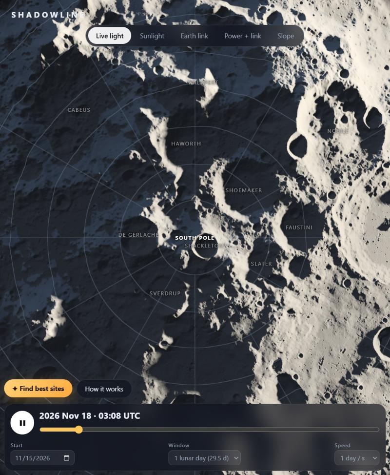

# Shadowline — Lunar Landing Site Navigator

Fly over the Moon's south pole, watch real sunlight sweep across it, and click anywhere to test a landing site for **power** (sunlight) and **contact with Earth**.

Built for the NASA Space Apps Challenge 2026 (November 14–15, 2026).

**Live app:** https://klauscreates.github.io/shadowline/ · **Demo slides:** https://klauscreates.github.io/shadowline/demo/



## What it does

- **Live light.** Real shadows on real terrain for any date and time, drawn in the browser.
- **Heat maps.** Share of a time window each spot is sunlit, has Earth above the horizon, or both.
- **Site test.** Click anywhere: sunlight %, longest dark stretch, Earth-in-view %, longest loss of contact, slope, a 360° horizon view, and a timeline you can click to jump in time.
- **Find best sites.** One button scans the whole map and pins the three best-scoring spots.
- **Countdowns.** Each site shows the time to the next sunset or sunrise and the next Earthset or Earthrise from the selected moment.
- **Add a site.** Type coordinates, or pick from a short list of notable south-pole sites (approximate coordinates).
- **Compare.** Up to four pins in one side-by-side table, with the best value in each row marked.
- **Mission and launch slip.** Set a mission length and see the same mission arriving on time and 1, 3 and 7 days late. "Find arrival windows" searches the next 60 days for the best arrival dates.
- **View from the site.** A low camera view across a site toward the Sun or Earth.
- **Open numbers.** Each site report shows how its score adds up, and exports the full time series (UTC, Sun and Earth elevation and azimuth, visibility) as CSV.
- **Phone and desktop.** Touch controls and a layout that fits an iPhone, a tablet or a wide monitor.

## Run it

No build step. Any static file server works:

```sh
python -m http.server 5178
```

Then open http://localhost:5178. Needs a browser with WebGL2.

## How it works

| Piece | Method |
| --- | --- |
| Terrain | NASA LOLA south-pole elevation model, 512 km across, resampled to 250 m per pixel |
| Sun and Earth positions | astronomy-engine orbit + IAU lunar rotation model, computed in the browser |
| Shadows | A ray is marched from every map point towards the Sun and Earth over the curved Moon; the Sun is a disk, so edges are soft |
| Heat maps | The same test repeated across the window on the GPU and added up |
| Site test | Horizon measured in 720 directions, then stepped through the window |
| Score | 45% sunlight + 35% Earth in view + 20% gentle slope; halved above 15° slope |

### Checks

- Sun and Earth positions agree with **NASA JPL Horizons to 0.008°** over 396 daily dates (Nov 2026 to Dec 2027): `node tools/check_horizons.mjs`.
- Sun and Earth positions agree with NASA SPICE (DE440, `MOON_ME` frame) to **0.004°** over 134 dates across 13 months: `node tools/check_ephemeris.mjs`.
- GPU heat maps agree with the independent CPU site test to **0.1% on average (1% worst case)** over 60 random points.

### Limits

- 250 m per pixel: boulders, small craters and local ridges are not seen.
- "Earth in view" means the centre of Earth is above the terrain horizon for an antenna 2 m above ground. It is not a radio link budget.
- The score is a comparison aid, not a mission rule.
- Research and education only. Not flight planning software.

## Rebuilding the terrain file

```sh
curl -o tools/raw/LDEM_60S_240MPP_ADJ.TIF https://pgda.gsfc.nasa.gov/data/LOLA_20mpp/LDEM_60S_240MPP_ADJ.TIF
python tools/build_terrain.py tools/raw/LDEM_60S_240MPP_ADJ.TIF   # needs numpy, scipy, rasterio
```

## Data and credits

- **Elevation:** LOLA `LDEM_60S_240MPP_ADJ`, NASA GSFC Planetary Geodesy Data Archive (LRO LOLA team).
- **Reference ephemeris for the check:** NASA NAIF SPICE kernels (DE440).
- **Libraries:** [three.js](https://threejs.org) (MIT), [astronomy-engine](https://github.com/cosinekitty/astronomy) (MIT).

## Disclosures

- **AI use:** the code in this repository was written with Claude (Anthropic) as a coding assistant, directed and reviewed by the author.
- **Prior work:** the author explored the same idea earlier in a separate personal project. No code from it is used here. Everything in this repository, including the terrain file (regenerated from the NASA source), was made during the hackathon.
